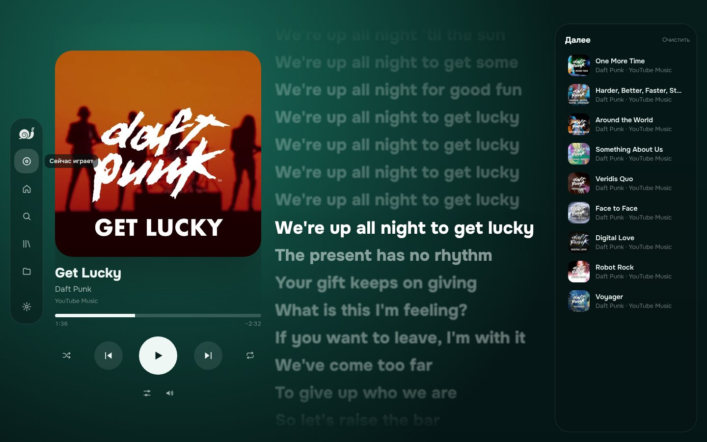
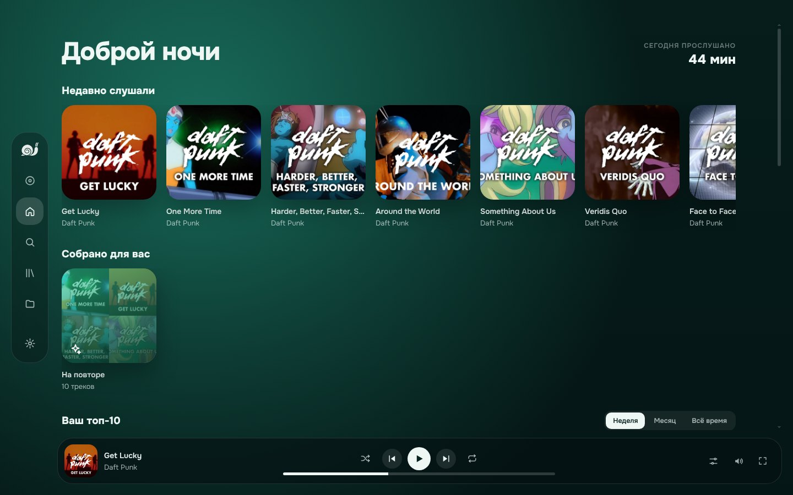
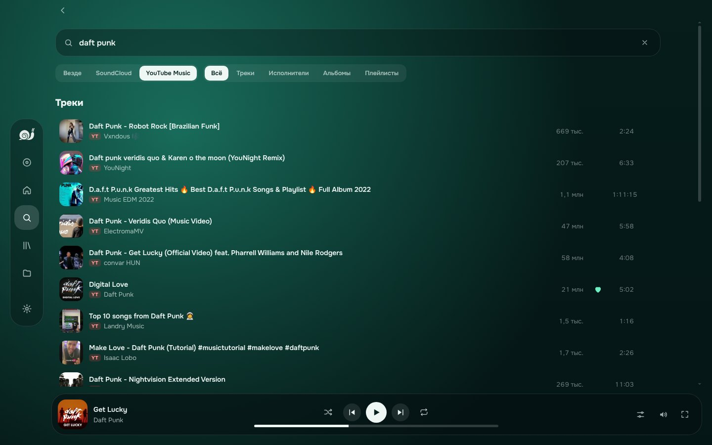
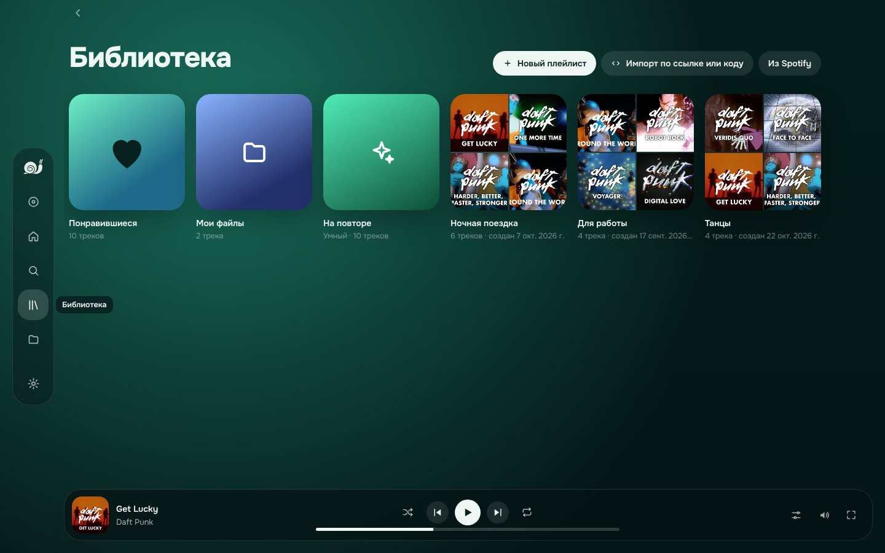
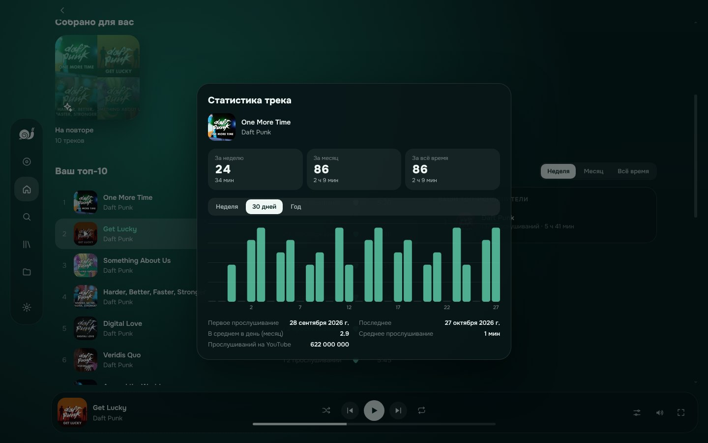
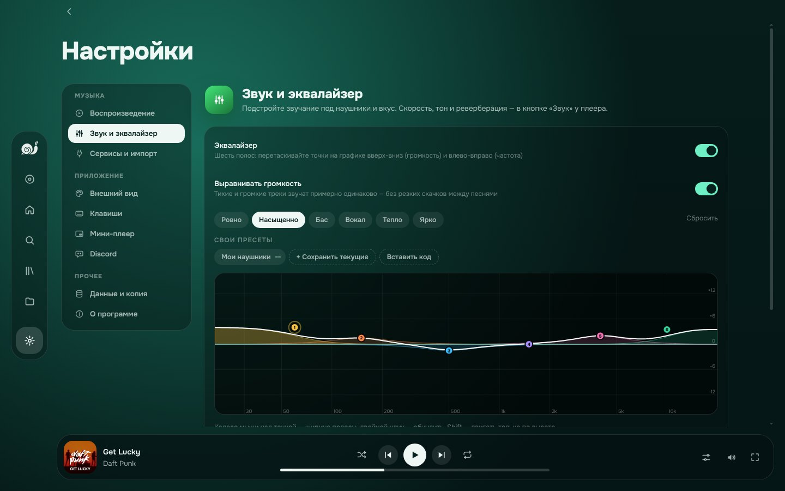
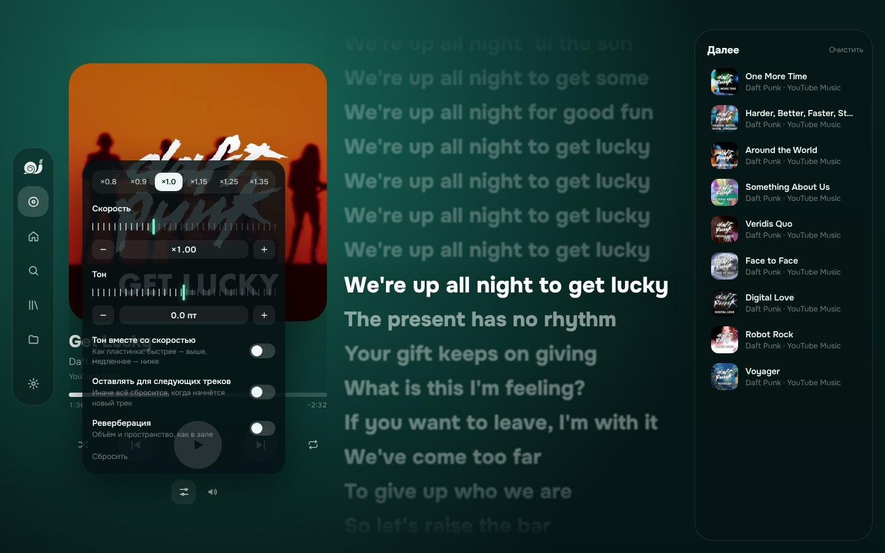
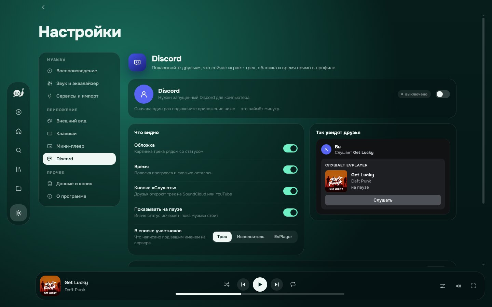
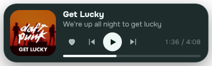

<div align="center">

<a href="https://github.com/Evire1337/evplayer/releases/latest">
  
</a>

# EvPlayer

**SoundCloud, YouTube Music и ваши файлы в одном плеере — для Windows, Linux и Android**<br />
Живой фон из обложки, текст песен строка за строкой, эквалайзер, офлайн, статистика и мини-плеер поверх окон.<br />
Без рекламы, без регистрации, бесплатно и с открытым кодом.

[](https://github.com/Evire1337/evplayer/releases/latest)
[](https://github.com/Evire1337/evplayer/releases)
[](https://github.com/Evire1337/evplayer/stargazers)
[](LICENSE)
[](https://github.com/Evire1337/evplayer/actions)


 


[](https://t.me/evvplayer)

<a href="https://github.com/Evire1337/evplayer/releases/latest">
  
</a>
<a href="https://github.com/Evire1337/evplayer/releases/latest">
  
</a>
<a href="https://github.com/Evire1337/evplayer/releases/latest">
  
</a>

<br /><br />



</div>

---

## Что это

EvPlayer — музыкальный плеер для **Windows**, **Linux** (x64 и ARM, в том числе пакет для Arch) и **Android**. Ищет сразу по **SoundCloud** и **YouTube Music**, играет **ваши файлы** (MP3, FLAC, M4A, OGG, WAV) и складывает всё в одну библиотеку: в одном плейлисте могут лежать треки из всех источников вперемешку. Плейлисты из **Spotify**, **Яндекс Музыки** и **Deezer** переносятся по ссылке, а из **ВКонтакте** — списком: песни находятся автоматически. Любой трек, плейлист или лайки можно **скачать** и слушать без интернета.

Всё хранится на вашем устройстве: никаких аккаунтов и серверов EvPlayer. Обновления приходят сами.

## Возможности

<table>
<tr>
<td width="50%" valign="top">

**🎧 Воспроизведение**
- Поиск по SoundCloud и YouTube Music: треки, исполнители, альбомы, плейлисты
- История поиска; результаты не теряются, пока вы в плеере
- Очередь с перетаскиванием, перемешивание, повтор, «Радио по треку»
- Плавный переход между треками; трек, который не включается, сам сменяется следующим
- Автовоспроизведение похожих, когда очередь закончилась
- Продолжение с того же места после перезапуска
- Скорость, тон (отдельно или как у пластинки) и реверберация
- Офлайн: скачанные треки, плейлисты и лайки играют без интернета

**🎚 Звук**
- Параметрический эквалайзер на 6 полос и расширенный на 10, ±24 дБ, с живым спектром
- Пресеты (плавно сменяют друг друга) и свои пресеты: перетаскивание, обмен кодом
- Выравнивание громкости между треками, защита от хрипа по желанию

**📝 Тексты**
- Синхронный текст из LRCLIB: строки подсвечиваются в такт, по клику — перемотка
- Сдвиг текста для песни, если он спешит или отстаёт (запоминается)
- Обычный текст с Genius, если синхронного нет

</td>
<td width="50%" valign="top">

**📚 Библиотека**
- Понравившиеся и свои плейлисты с обложками и перестановкой треков
- Умные плейлисты: «На повторе», «Новые открытия», «Забытые любимые»
- Свои файлы: папки обновляются сами, теги и обложки можно править
- Импорт по ссылке: Spotify, Яндекс Музыка, YouTube, SoundCloud, Deezer; списком — из ВКонтакте и откуда угодно
- Импорт архива данных Spotify; вход в SoundCloud с синхронизацией лайков и плейлистов
- Обмен плейлистами и лайками одной строкой-кодом, резервная копия
- «Недавно слушали» с плейлистами и альбомами

**📊 Статистика**
- Топ-10 треков и исполнителей за неделю, месяц и всё время
- График прослушиваний любого трека, «сегодня прослушано»

**🪟 Компьютер**
- Мини-плеер поверх всех окон (уступает место полноэкранным играм), трей, медиаклавиши
- Свои горячие клавиши в окне и глобально
- Статус «Слушает» в Discord с обложкой и временем
- Режим экономии памяти
- Автообновление через GitHub Releases

**📱 Android**
- Управление из шторки и с экрана блокировки, виджет на рабочий стол
- Музыка играет в фоне, приложение не закрывается в других приложениях
- Ничего не кэширует на телефон

</td>
</tr>
</table>

## Скриншоты

<table>
<tr>
<td><p align="center"><sub>Главная: недавнее, умные плейлисты, топы</sub></p></td>
<td><p align="center"><sub>Поиск по SoundCloud и YouTube Music</sub></p></td>
</tr>
<tr>
<td><p align="center"><sub>Библиотека</sub></p></td>
<td><p align="center"><sub>Статистика трека</sub></p></td>
</tr>
<tr>
<td><p align="center"><sub>Эквалайзер</sub></p></td>
<td><p align="center"><sub>Скорость, тон и реверберация</sub></p></td>
</tr>
<tr>
<td><p align="center"><sub>Статус в Discord</sub></p></td>
<td align="center" valign="middle"><p align="center"><sub>Мини-плеер поверх окон</sub></p></td>
</tr>
</table>

## Скачать

Все файлы — в [последнем релизе](https://github.com/Evire1337/evplayer/releases/latest).

| Система | Файл |
|---|---|
| Windows 10 / 11, 64 бит | `EvPlayer_x.y.z_x64-setup.exe` |
| Linux x64 | `EvPlayer_x.y.z_amd64.AppImage` (обновляется сам), `.deb` или `.rpm` |
| Linux ARM (aarch64) | `EvPlayer_x.y.z_aarch64.AppImage`, `_arm64.deb` или `.aarch64.rpm` |
| Arch Linux | `evplayer-bin-x.y.z-1-x86_64.pkg.tar.zst` (`sudo pacman -U …`) или `PKGBUILD` из релиза: `makepkg -si` (так и на Arch Linux ARM) |
| Android 7+ | `EvPlayer-x.y.z.apk` |

> [!NOTE]
> Установщик для Windows пока не подписан сертификатом, поэтому SmartScreen может показать «Windows защитила ваш компьютер». Нажмите **Подробнее → Выполнить в любом случае**.
>
> На Linux AppImage нужно сделать исполняемым: `chmod +x EvPlayer_*.AppImage`. На Android при установке APK разрешите установку из этого источника. При первом запуске телефон спросит про работу в фоне — разрешите, чтобы музыка не прерывалась.

## Обновления

EvPlayer сам проверяет новые версии при запуске и каждые 4 часа. На Windows и в Linux AppImage обновление скачивается в фоне и ставится при следующем перезапуске — переустанавливать ничего не нужно. Пакеты `.deb` и `.rpm` обновляются установкой нового пакета, а на Android приложение предложит скачать новый APK. Проверить вручную: **Настройки → О программе**.

## Импорт из других сервисов

| Откуда | Как | Что переносится |
|---|---|---|
| Spotify | ссылка на плейлист, альбом или трек | весь плейлист, без входа |
| Spotify | «Войти через Spotify» в «Сервисах» | «Любимые треки» и все ваши плейлисты целиком |
| Spotify | архив «Скачать свои данные» | любимые, все плейлисты, самое слушаемое |
| YouTube / YouTube Music | ссылка на плейлист или видео | весь плейлист |
| SoundCloud | ссылка или профиль в «Сервисах» | треки, плейлисты, ваши публичные лайки |
| SoundCloud | «Войти» в «Сервисах» | лайки и плейлисты; с полной синхронизацией — изменения в плеере попадают и в аккаунт |
| Deezer | ссылка на плейлист, альбом или трек | весь плейлист |
| Яндекс Музыка | ссылка или профиль в «Сервисах» | плейлисты, альбомы, публичное «Мне нравится» |
| ВКонтакте | список, скопированный со страницы плейлиста или «Моей музыки» | все скопированные треки |
| Любой список | строки «Исполнитель — Название» | все песни из списка |
| EvPlayer | код `EVP2.…` от друга | плейлист целиком с обложкой; код «Понравившихся» добавляется к лайкам |

Всё это — в **Библиотека → Импорт**. Песни из Spotify, Deezer, Яндекс Музыки и списков ищутся на YouTube Music и SoundCloud; если уверенного совпадения нет, трек пропускается. Сколько уже найдено, видно в окошке загрузки.

> [!TIP]
> **Из ВКонтакте.** ВКонтакте не даёт сторонним приложениям читать музыку, поэтому перенос — через копирование: откройте плейлист или «Мою музыку» на vk.com в браузере, выделите треки мышью, скопируйте и вставьте в окно импорта.

## Горячие клавиши

Все клавиши меняются в **Настройки → Клавиши**. По умолчанию:

| В окне | | Везде в системе | |
|---|---|---|---|
| `Пробел` | играть / пауза | `Ctrl+Alt+Пробел` | играть / пауза |
| `Ctrl+→` / `Ctrl+←` | следующий / предыдущий | `Ctrl+Alt+→` / `←` | следующий / предыдущий |
| `→` / `←` | перемотка на 5 с | `Ctrl+Alt+L` | нравится |
| `↑` / `↓` | громкость | `Ctrl+Alt+M` | мини-плеер |
| `L` / `M` / `S` / `R` | нравится / без звука / перемешать / повтор | `Ctrl+Alt+E` | показать окно |
| `Ctrl+F` / `Ctrl+,` | поиск / настройки | медиаклавиши | работают всегда |

## Где хранятся данные

| Что | Windows | Linux |
|---|---|---|
| Библиотека, статистика, настройки, скачанное | `%APPDATA%\EvPlayer` | `~/.config/EvPlayer` |
| Список ваших файлов и обложки к ним | `local-tracks.json`, `local-covers\` там же | там же |
| Резервная копия | файл `.json`, который вы сохраняете в **Настройки → Данные и копия** | |

На Android всё хранится внутри приложения; кэш на телефон не пишется.

## Сборка из исходников

Нужны [Node.js 22+](https://nodejs.org), [pnpm](https://pnpm.io) (`npm i -g pnpm`) и [Rust](https://rustup.rs). На Windows ещё «Средства сборки C++» из [Visual Studio Build Tools](https://visualstudio.microsoft.com/visual-cpp-build-tools/) (галочка «Разработка классических приложений на C++»). На Linux — системные библиотеки:

```bash
sudo apt install libwebkit2gtk-4.1-dev libayatana-appindicator3-dev librsvg2-dev libxdo-dev libssl-dev patchelf file
```

```powershell
git clone -b tauri https://github.com/Evire1337/evplayer.git
cd evplayer
pnpm install
pnpm dev          # запуск с горячей перезагрузкой (первый раз Rust собирается несколько минут)
```

| Команда | Что делает |
|---|---|
| `pnpm dev` | приложение в режиме разработки: правки в `src/` применяются сразу |
| `pnpm test` | тесты интерфейса (Vitest) |
| `cargo test` в `src-tauri` | тесты части на Rust |
| `pnpm typecheck` | проверка типов |
| `pnpm tauri build` | установщик в `src-tauri/target/release/bundle/nsis/` (на Linux — `--bundles deb,rpm,appimage`) |
| `pnpm tauri android build --apk` | APK (нужны Android SDK и NDK) в `src-tauri/gen/android/app/build/outputs/apk/` |

**Отладка.** В режиме `pnpm dev` правый клик → «Inspect» (или `Ctrl+Shift+I`) открывает инструменты разработчика. Сообщения Rust-части печатаются в терминал, где запущен `pnpm dev`.

### Как выпустить новую версию

1. Поменяйте `version` в `package.json` (и в `src-tauri/Cargo.toml`) и закоммитьте.
2. `git tag v0.6.0` → `git push origin v0.6.0`
3. GitHub Actions соберёт Windows, Linux (x64 и ARM, а также пакет для Arch) и Android, подпишет обновления и опубликует релиз с `latest.json`, когда все файлы на месте — у всех пользователей обновление придёт само.

Тестовые версии для всех систем собираются вручную: вкладка Actions → Check → Run workflow (файлы внизу запуска). APK отдельно — Actions → Android. Пуши сами ничего не собирают.

Секреты в настройках репозитория (Settings → Secrets and variables → Actions):
- `TAURI_SIGNING_PRIVATE_KEY` — закрытый ключ обновлений, пара к `pubkey` в `src-tauri/tauri.conf.json`;
- `ANDROID_KEYSTORE` (файл `.jks` в base64) и `ANDROID_KEY_PASSWORD` — подпись APK.

## Стек

| Часть | Технологии |
|---|---|
| Оболочка | Tauri 2 (WebView2 на Windows, WebKitGTK на Linux, WebView на Android), Rust: трей, клавиши, мини-плеер, Discord, файлы, офлайн, обновления |
| Android | Kotlin: уведомление и экран блокировки (MediaSession), виджет, работа в фоне |
| Интерфейс | React 19, TypeScript, Vite |
| Состояние | Zustand |
| Звук | Web Audio API: свой AudioWorklet для тона, свёрточная реверберация, BiquadFilter-эквалайзер, лимитер |
| Потоки | hls.js; если источник не играет — другой формат, затем та же запись на другом сервисе (без ремиксов) |
| Сеть | свой прокси на Rust для запросов к сервисам и маленький медиасервер на 127.0.0.1 для звука |
| Файлы | lofty (теги), notify (слежение за папками), отдача с поддержкой перемотки |
| Фон | свой WebGL-шейдер из цветов обложки |
| Тесты и CI | Vitest, GitHub Actions |

## Ветки

- `tauri` — основная ветка: Windows, Linux и Android на Tauri (этот код)
- `android` — тестовые сборки APK
- `desktop` — прежняя версия на Electron (больше не развивается)

## Звёзды

<a href="https://star-history.com/#Evire1337/evplayer&Date">
  
</a>

## Участие

Как ведутся задачи и как прислать свои изменения — в [CONTRIBUTING.md](CONTRIBUTING.md). Как устроен код, как его писать и тестировать — в [AGENTS.md](AGENTS.md); этот файл можно отдать и ИИ-ассистенту.

## Лицензия

[MIT](LICENSE) © Evire1337

EvPlayer — независимый проект и не связан с SoundCloud, YouTube, Google, Spotify, Deezer, Яндексом, ВКонтакте, Apple или Discord. Названия сервисов принадлежат их владельцам. Музыка воспроизводится через публичные сервисы этих платформ; тексты песен — LRCLIB и Genius.

<div align="center">
<br />
<a href="https://github.com/Evire1337/evplayer/releases/latest">
  
</a>
</div>
