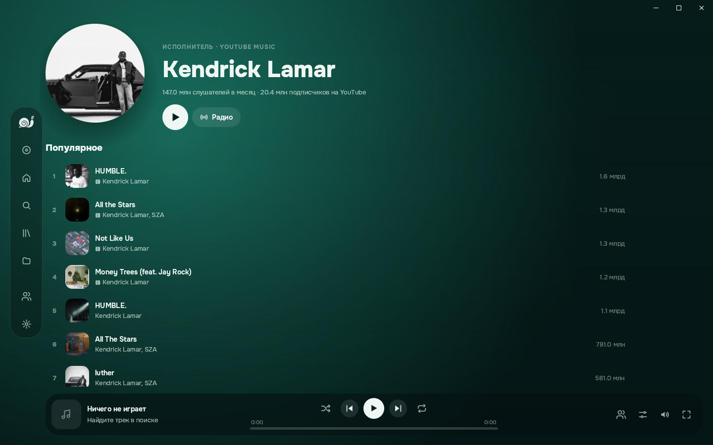
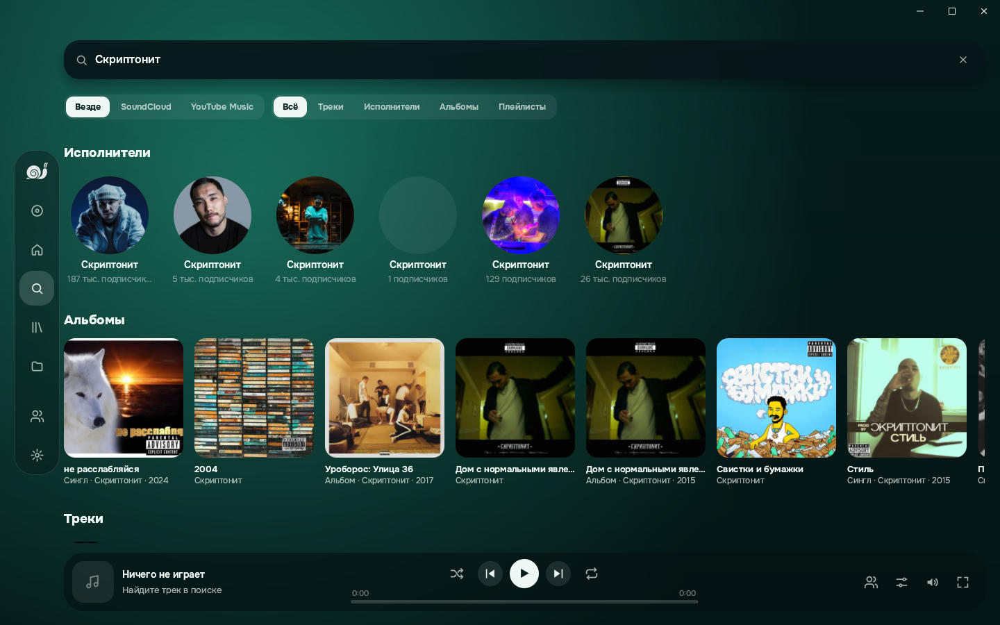
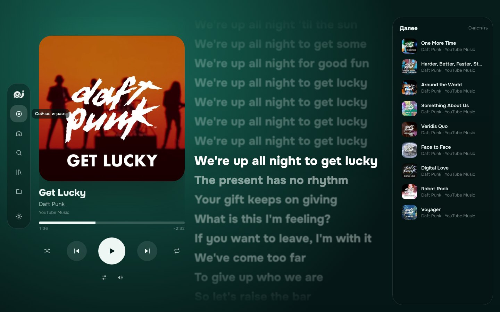
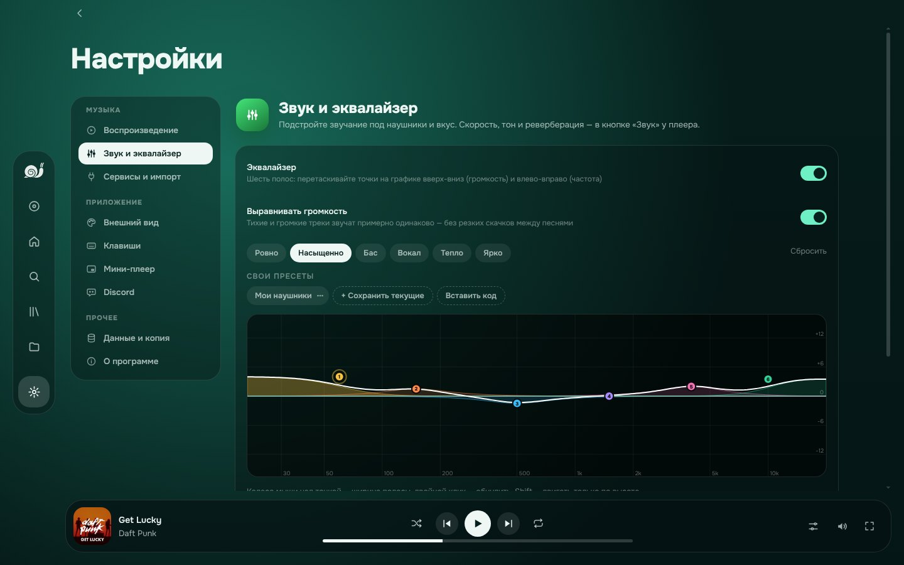

<div align="center">

<a href="https://github.com/Evire1337/evplayer/releases/latest">
  
</a>

# EvPlayer

**Музыкальный плеер: SoundCloud, YouTube Music и ваши файлы в одной библиотеке**<br />
Нативная версия для Windows — целиком на Rust, без браузерного движка: **13 МБ памяти в трее**, один процесс.<br />
Без рекламы, без регистрации, бесплатно и с открытым кодом.

*A free, open-source music player for SoundCloud, YouTube Music and your own files — native Rust, no web engine, 13 MB of RAM in the tray. [English below](#english).*

[](https://github.com/Evire1337/evplayer/releases/latest)
[](https://github.com/Evire1337/evplayer/releases)
[](https://github.com/Evire1337/evplayer/stargazers)
[](LICENSE)


[](https://t.me/evvplayer)

<a href="https://github.com/Evire1337/evplayer/releases/latest">
  
</a>

<br /><br />



<sub>Если проект пригодился — поставьте ⭐: так его найдут другие.</sub>

</div>

---

## Что это

EvPlayer — бесплатный музыкальный плеер. Ищет сразу по **SoundCloud** и **YouTube Music**, играет **ваши файлы** (MP3, FLAC, ALAC, M4A, OGG/Opus, WAV) и складывает всё в одну библиотеку: в одном плейлисте могут лежать треки из всех источников вперемешку. Плейлисты из **Spotify**, **Яндекс Музыки** и **Deezer** переносятся по ссылке, а из **ВКонтакте** — списком. Любой трек, плейлист или лайки можно **скачать** и слушать без интернета. Никаких аккаунтов и серверов EvPlayer — всё хранится у вас.

Эта ветка — **нативная версия для Windows** (папка [`native/`](native)): тот же плеер, что и в [Tauri-версии](https://github.com/Evire1337/evplayer/tree/tauri), но без WebView. Окно рисует видеокарта через Direct3D 11 (интерфейс на egui), звук декодируется и сводится в самой программе и идёт через WASAPI. Данные у обеих версий общие: при первом запуске библиотека, плейлисты и настройки переезжают сами.

### Нативная против Tauri

| | Tauri 0.7.6 | Нативная |
|---|---|---|
| Процессов | 8 (программа и WebView2) | **1** |
| Потоков | 250 | **40** |
| Память (своя, private) | 291 МБ | **102 МБ**, в трее — **13 МБ** |
| Процессор в простое, за 10 с | 1,41 с | **0,04 с** |
| Свёрнута 25 с | 294 МБ | **25 МБ** |

Как и на чём мерили — в [native/README.md](native/README.md#замеры).

## Возможности

<table>
<tr>
<td width="50%" valign="top">

**🎧 Воспроизведение**
- Поиск по SoundCloud и YouTube Music: треки, исполнители, альбомы, плейлисты
- Если трек не играет — тот же трек с другого сервиса, **без ремиксов и чужих версий**
- Ярлыки версий у названий: «ремикс», «speed up», «slowed», «кавер», «пародия»
- Без запиканного мата: находится нецензурная версия песни
- Лучший звук: Opus ~160 кбит/с с YouTube, AAC 160 кбит/с с SoundCloud, ресемплер ровный до 20 кГц
- Очередь с перетаскиванием, перемешивание, повтор, «Радио по треку», кроссфейд без пауз
- Скорость, тон и реверберация; офлайн: скачанное играет без интернета

**🎚 Звук**
- Параметрический эквалайзер на 6 и 10 полос с живым спектром, свои пресеты с кодами
- Выравнивание громкости между треками, защита от перегрузки

**📝 Тексты**
- Синхронный текст: строки подсвечиваются в такт, клик — перемотка, сдвиг текста

</td>
<td width="50%" valign="top">

**📚 Библиотека**
- Понравившиеся и свои плейлисты, мозаика обложек, перестановка треков
- Умные плейлисты: «На повторе», «Новые открытия», «Забытые любимые»
- Свои файлы: папки отслеживаются, теги и обложки правятся
- Импорт: Spotify, Яндекс Музыка, YouTube, SoundCloud, Deezer, ВКонтакте, архив Spotify
- Обмен плейлистами одной строкой-кодом, резервная копия

**📊 Статистика**
- Топ-10 треков и исполнителей за неделю, месяц и всё время, график по каждому треку

**🪟 Windows**
- Мини-плеер поверх окон, трей, медиаклавиши и плашка Windows, свои горячие клавиши
- Статус в Discord, «Слушать вместе» с друзьями (совместимо с Tauri-версией)
- Свёрнутое окно отпускает видеокарту и память

</td>
</tr>
</table>

## Скриншоты

<table>
<tr>
<td><p align="center"><sub>Поиск по SoundCloud и YouTube Music</sub></p></td>
<td><p align="center"><sub>Страница исполнителя</sub></p></td>
</tr>
<tr>
<td><p align="center"><sub>«Сейчас играет» с текстом песни</sub></p></td>
<td><p align="center"><sub>Эквалайзер</sub></p></td>
</tr>
</table>

## Скачать

Готовые установщики — в [последнем релизе](https://github.com/Evire1337/evplayer/releases/latest). Сейчас это Tauri-версия для Windows, Linux (в том числе Arch) и Android; нативная сборка для Windows скоро появится там же, а пока её можно собрать самому (ниже).

| Система | Файл |
|---|---|
| Windows 10 / 11, 64 бит | `EvPlayer_x.y.z_x64-setup.exe` |
| Linux x64 / ARM | `.AppImage` (обновляется сам), `.deb` или `.rpm` |
| Arch Linux | `evplayer-bin-…pkg.tar.zst` или `PKGBUILD` из релиза |
| Android 7+ | `EvPlayer-x.y.z.apk` |

> [!NOTE]
> Установщик пока не подписан сертификатом, поэтому SmartScreen может показать «Windows защитила ваш компьютер». Нажмите **Подробнее → Выполнить в любом случае**.

## Нативная сборка из исходников

Нужны [Rust](https://rustup.rs) (1.85+), [Visual Studio Build Tools](https://visualstudio.microsoft.com/visual-cpp-build-tools/) с «Разработкой классических приложений на C++» и [CMake](https://cmake.org) (для libopus).

```powershell
git clone -b native/rust https://github.com/Evire1337/evplayer.git
cd evplayer\native
cargo build --release      # target\release\evplayer-native.exe — один файл
cargo test                 # тесты; с сетью: cargo test -- --ignored net_
```

Посмотреть страницу без окна: `evplayer-native.exe --snapshot out.png --page search:кино`. Устройство, перенос с Tauri и замеры — в [native/README.md](native/README.md).

## Импорт из других сервисов

| Откуда | Как | Что переносится |
|---|---|---|
| Spotify | ссылка на плейлист, альбом или трек | весь плейлист, без входа |
| Spotify | «Войти через Spotify» в «Сервисах» | «Любимые треки» и все ваши плейлисты целиком |
| Spotify | архив «Скачать свои данные» | любимые, все плейлисты, самое слушаемое |
| YouTube / YouTube Music | ссылка на плейлист или видео | весь плейлист |
| SoundCloud | ссылка или профиль в «Сервисах» | треки, плейлисты, ваши публичные лайки |
| SoundCloud | «Войти» в «Сервисах» | лайки и плейлисты; с полной синхронизацией — изменения в плеере попадают и в аккаунт |
| Deezer | ссылка на плейлист, альбом или трек | весь плейлист |
| Яндекс Музыка | ссылка или профиль в «Сервисах» | плейлисты, альбомы, публичное «Мне нравится» |
| ВКонтакте | список, скопированный со страницы плейлиста или «Моей музыки» | все скопированные треки |
| Любой список | строки «Исполнитель — Название» | все песни из списка |
| EvPlayer | код `EVP2.…` от друга | плейлист целиком с обложкой; код «Понравившихся» добавляется к лайкам |

Всё это — в **Библиотека → Импорт**. Песни из Spotify, Deezer, Яндекс Музыки и списков ищутся на YouTube Music и SoundCloud; если уверенного совпадения нет, трек пропускается. Сколько уже найдено, видно в окошке загрузки.

> [!TIP]
> **Из ВКонтакте.** ВКонтакте не даёт сторонним приложениям читать музыку, поэтому перенос — через копирование: откройте плейлист или «Мою музыку» на vk.com в браузере, выделите треки мышью, скопируйте и вставьте в окно импорта.

## Горячие клавиши

Все клавиши меняются в **Настройки → Клавиши**. По умолчанию:

| В окне | | Везде в системе | |
|---|---|---|---|
| `Пробел` | играть / пауза | `Ctrl+Alt+Пробел` | играть / пауза |
| `Ctrl+→` / `Ctrl+←` | следующий / предыдущий | `Ctrl+Alt+→` / `←` | следующий / предыдущий |
| `→` / `←` | перемотка на 5 с | `Ctrl+Alt+L` | нравится |
| `↑` / `↓` | громкость | `Ctrl+Alt+M` | мини-плеер |
| `L` / `M` / `S` / `R` | нравится / без звука / перемешать / повтор | `Ctrl+Alt+E` | показать окно |
| `Ctrl+F` / `Ctrl+,` | поиск / настройки | медиаклавиши | работают всегда |

## Где хранятся данные

| Что | Windows | Linux |
|---|---|---|
| Библиотека, статистика, настройки, скачанное | `%APPDATA%\EvPlayer` | `~/.config/EvPlayer` |
| Список ваших файлов и обложки к ним | `local-tracks.json`, `local-covers\` там же | там же |
| Резервная копия | файл `.json`, который вы сохраняете в **Настройки → Данные и копия** | |

На Android всё хранится внутри приложения; кэш на телефон не пишется.


## English

**EvPlayer** is a free, open-source music player that searches **SoundCloud** and **YouTube Music** at once, plays **your own files** (MP3, FLAC, ALAC, M4A, OGG/Opus, WAV) and keeps everything in one library — a playlist can mix songs from every source. Playlists move over from **Spotify**, **Yandex Music**, **Deezer** and **VK** by link or as a list of songs; anything can be **downloaded** and played offline. No accounts, no EvPlayer servers, no ads.

This branch is the **native Windows build**: the whole player in **Rust**, no web engine. The window is drawn by the GPU through **Direct3D 11** (UI in **egui**), sound is decoded and mixed in-process and played through **WASAPI**. One process, about **100 MB** with the window open and **13 MB** in the tray, next to ~290 MB for the Tauri/WebView2 build.

- **Search** SoundCloud and YouTube Music: songs, artists, albums, playlists
- **Right copy, right version**: when a song does not play, the same recording from the other service — never a remix, a sped-up upload or someone else's cover; version labels ("remix", "speed up", "slowed") next to titles; uncensored versions instead of bleeped ones
- **Sound**: Opus ~160 kbit/s from YouTube, AAC 160 kbit/s from SoundCloud, a resampler flat to 20 kHz, gapless playback and crossfade, 6- and 10-band parametric EQ, loudness levelling, speed, pitch and reverb
- **Synced lyrics**, smart playlists, listening statistics, a mini player above all windows, media keys, Discord status, "Listen together" sessions
- **Import** from Spotify (links, account or data archive), Yandex Music, Deezer, YouTube, SoundCloud and VK

Download the installers from the [latest release](https://github.com/Evire1337/evplayer/releases/latest) (currently the Tauri build for Windows, Linux and Android), or build the native one with `cargo build --release` in `native/`. If you like it, a ⭐ helps others find it.

## Ветки

- `native/rust` — нативная версия для Windows на Rust (эта ветка, следующая версия EvPlayer)
- `tauri` — Windows, Linux и Android на Tauri (текущие релизы)
- `android` — тестовые сборки APK

## Участие

Как ведутся задачи и как прислать изменения — в [CONTRIBUTING.md](CONTRIBUTING.md); как устроен код — в [AGENTS.md](AGENTS.md) и [native/README.md](native/README.md). Нашли ошибку или есть идея — [откройте issue](https://github.com/Evire1337/evplayer/issues/new/choose). Новости — в [Telegram](https://t.me/evvplayer).

## Звёзды

<a href="https://star-history.com/#Evire1337/evplayer&Date">
  
</a>

## Лицензия

[MIT](LICENSE) © Evire1337
